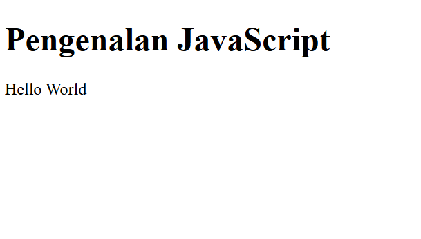
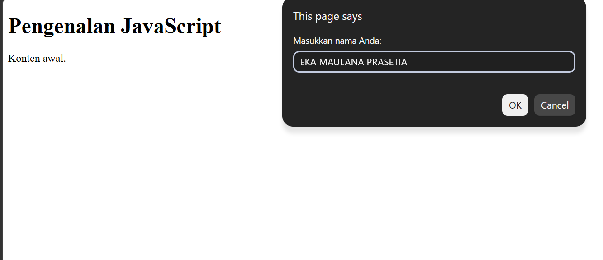
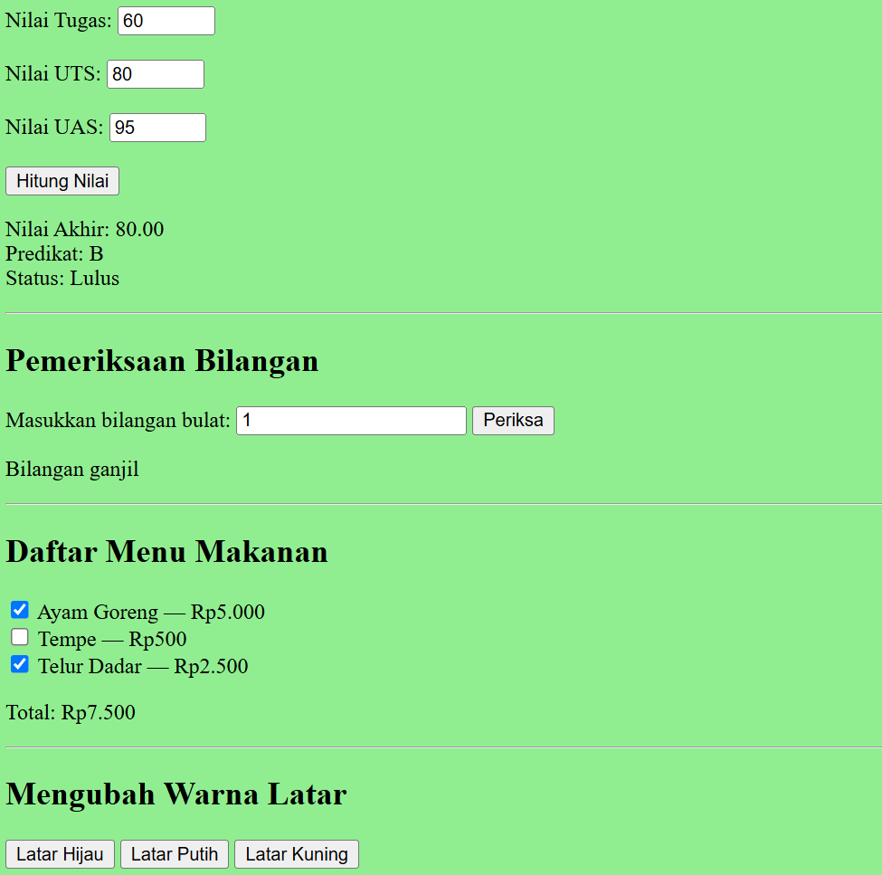
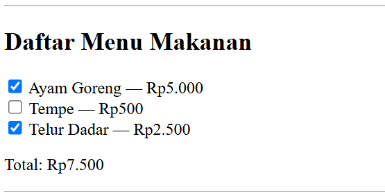
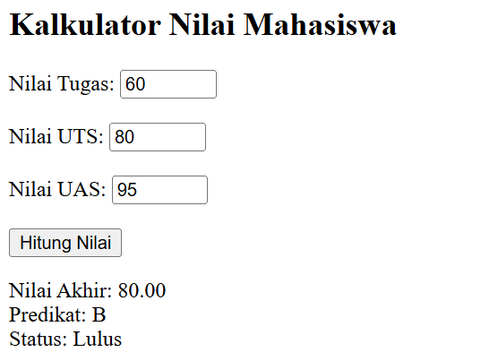

# Weblab5

### PROFIL
NAMA : EKA MAULANA PRASETIA
KELAS : I253A
PRODI : TEKNIK INFORMATIKA
NIM : 312510012

### JAWABAN PERTANYAAN DAN TUGAS 
# Jawaban Praktikum JavaScript Dasar

### 1. Jelaskan perbedaan `console.log()`, `alert()`, `prompt()`, dan `textContent`/`innerHTML`.

- `console.log()` digunakan untuk menampilkan pesan atau hasil program di Console. Biasanya dipakai untuk mengecek apakah kode berjalan dengan benar.
- `alert()` digunakan untuk menampilkan pesan dalam bentuk pop-up di browser.
- `prompt()` digunakan untuk meminta pengguna memasukkan data melalui pop-up.
- `textContent` digunakan untuk menampilkan atau mengubah teks di dalam elemen HTML.
- `innerHTML` digunakan untuk menampilkan atau mengubah isi HTML, termasuk tag HTML di dalamnya.

Contohnya, `textContent` hanya menampilkan teks, sedangkan `innerHTML` bisa menampilkan teks sekaligus elemen seperti `<b>` untuk membuat tulisan tebal.

### 2. Apa perbedaan `let` dan `const`? Berikan contoh.

`let` digunakan untuk membuat variabel yang nilainya masih bisa diubah. Sedangkan `const` digunakan untuk membuat variabel yang tidak bisa diberi nilai baru setelah dibuat.

Contoh:

```javascript
let umur = 19;
umur = 20;

const nama = "Eka";

console.log(umur);
console.log(nama);
```

Pada contoh tersebut, nilai `umur` bisa diubah dari 19 menjadi 20, sedangkan variabel `nama` tidak bisa diberi nilai baru.

### 3. Apa perbedaan operator `==` dan `===`?

Operator `==` digunakan untuk membandingkan dua nilai tanpa harus memiliki tipe data yang sama. Sedangkan `===` membandingkan nilai sekaligus tipe datanya.

Contoh:

```javascript
console.log(5 == "5");  // true
console.log(5 === "5"); // false
```

Hasil pertama adalah `true` karena JavaScript menyesuaikan tipe datanya. Hasil kedua adalah `false` karena angka 5 dan teks "5" memiliki tipe data yang berbeda.

Biasanya, `===` lebih disarankan supaya perbandingan lebih jelas.

### 4. Jelaskan fungsi `if–else` dan `switch`. Kapan masing-masing dapat digunakan?

`if–else` digunakan untuk menjalankan kode berdasarkan kondisi tertentu. Contohnya untuk menentukan apakah mahasiswa lulus atau belum lulus berdasarkan nilainya.

Contoh:

```javascript
let nilai = 80;

if (nilai >= 60) {
    console.log("Lulus");
} else {
    console.log("Belum lulus");
}
```

Sedangkan `switch` digunakan untuk memilih tindakan berdasarkan beberapa pilihan nilai yang sudah ditentukan, misalnya pilihan menu angka 1 sampai 5.

Contoh:

```javascript
let pilihan = "2";

switch (pilihan) {
    case "1":
        console.log("Menu satu");
        break;
    case "2":
        console.log("Menu dua");
        break;
    default:
        console.log("Pilihan tidak tersedia");
}
```

Jadi, `if–else` cocok untuk kondisi yang menggunakan perbandingan, sedangkan `switch` cocok untuk beberapa pilihan tertentu.

### 5. Apa fungsi parameter dan `return` dalam `function`?

Parameter adalah variabel yang digunakan untuk menerima data saat sebuah fungsi dipanggil. Sedangkan `return` digunakan untuk mengembalikan hasil dari fungsi agar bisa digunakan lagi.

Contoh:

```javascript
function tambah(a, b) {
    return a + b;
}

let hasil = tambah(5, 3);
console.log(hasil);
```

Pada contoh tersebut, `a` dan `b` adalah parameter. Fungsi `tambah()` mengembalikan hasil penjumlahan menggunakan `return`, sehingga hasilnya adalah 8.

### 6. Bagaimana JavaScript memilih elemen HTML menggunakan `document.getElementById()`?

`document.getElementById()` digunakan untuk mengambil elemen HTML berdasarkan atribut `id` yang dimilikinya.

Contoh HTML:

```html
<p id="pesan">Halo</p>
```

Contoh JavaScript:

```javascript
document.getElementById("pesan").textContent = "Selamat datang!";
```

Kode tersebut mencari elemen yang memiliki `id="pesan"`, lalu mengubah teksnya menjadi "Selamat datang!". Jadi, JavaScript bisa mengubah isi halaman HTML melalui elemen yang dipilih.

### 7. Buat script untuk memvalidasi form agar nama tidak kosong dan nilai berada pada rentang 0–100.

Berikut contoh HTML dan JavaScript sederhana untuk memeriksa nama dan nilai mahasiswa.

**HTML:**

```html
<label>Nama:</label>
<input type="text" id="nama">

<label>Nilai:</label>
<input type="number" id="nilai">

<button onclick="validasiForm()">Periksa</button>
<p id="hasil"></p>
```

**JavaScript:**

```javascript
function validasiForm() {
    const nama = document.getElementById("nama").value.trim();
    const inputNilai = document.getElementById("nilai").value;
    const nilai = Number(inputNilai);
    const hasil = document.getElementById("hasil");

    if (nama === "") {
        hasil.textContent = "Nama tidak boleh kosong!";
    } else if (
        inputNilai === "" ||
        !Number.isFinite(nilai) ||
        nilai < 0 ||
        nilai > 100
    ) {
        hasil.textContent = "Nilai harus berada pada rentang 0–100!";
    } else {
        hasil.textContent = "Data berhasil divalidasi.";
    }
}
```

Penjelasan:

- `trim()` digunakan untuk menghilangkan spasi di awal dan akhir nama.
- Jika nama kosong, program akan menampilkan pesan bahwa nama harus diisi.
- Nilai harus diisi dan berada di antara 0 sampai 100.
- Jika semua data sudah benar, program akan menampilkan pesan bahwa data berhasil divalidasi.

Dengan validasi ini, data yang dimasukkan bisa diperiksa terlebih dahulu sebelum diproses lebih lanjut.

### Menampilkan ouput


### Alert dan prompt


### Konsdisi seleksi if-else
1[Gambar 3](Screenshot5/Seleksi%20_kondisi_if–else.png)

### Form bilangan genap atau ganjil


### Mengubah warna halaman


### DOM dan checkbox menu makanan


### Kalkulator Nilai Mahasiswa
